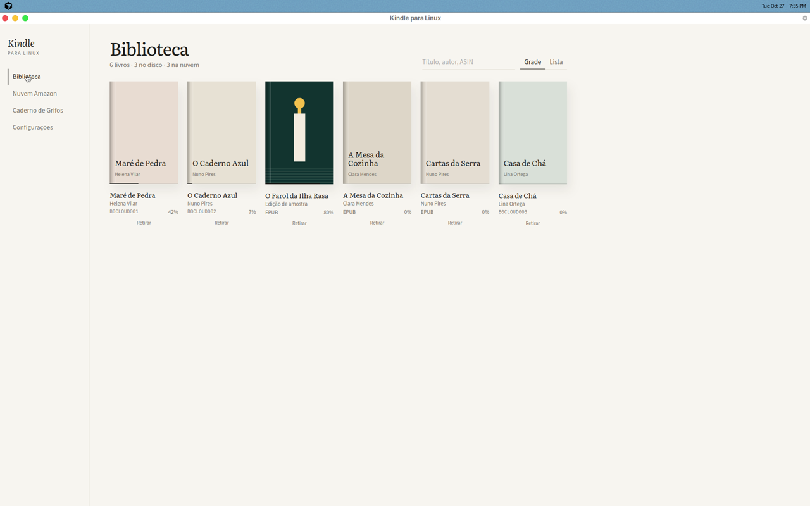
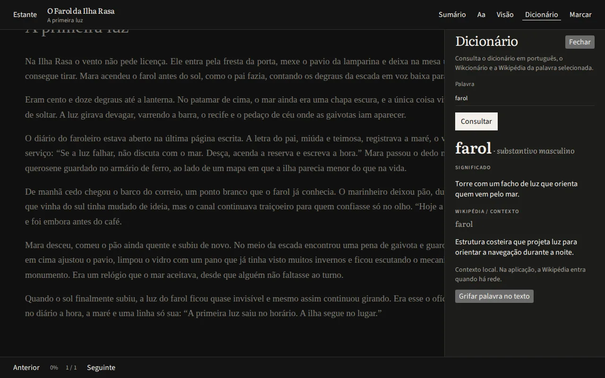
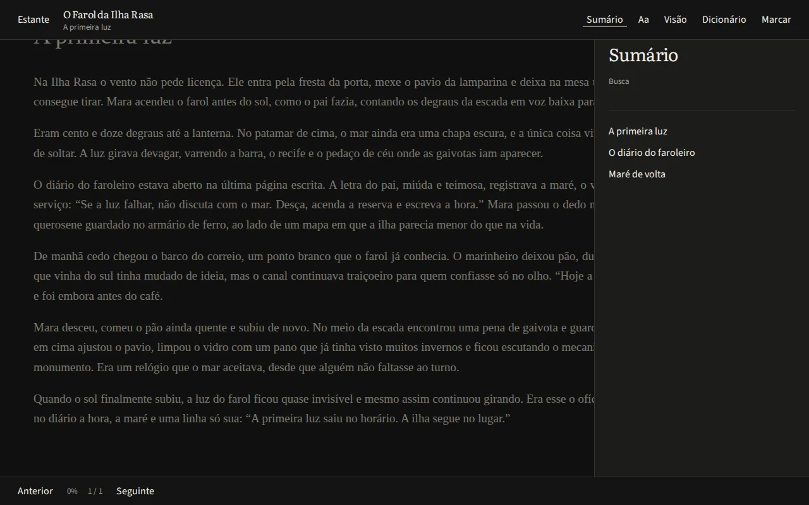
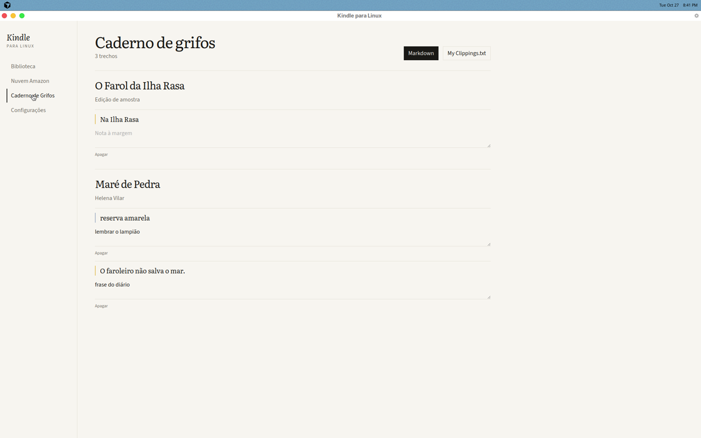

# Kindle para Linux

Kindle Cloud e EPUB na mesma estante.









## Instalar

Linux / macOS:

```bash
curl -fsSL https://joaopedrobs7.github.io/kindle-for-linux/install.sh | sh
```

Windows (PowerShell):

```bash
irm https://joaopedrobs7.github.io/kindle-for-linux/install.ps1 | iex
```

Os arquivos (`.deb`, `.AppImage`, `.dmg`, `.msi`) estão nas [Releases](https://github.com/Joaopedrobs7/kindle-for-linux/releases).

- Kindle Cloud (Brasil ou EUA) e EPUB local na mesma estante
- Temas Papel, Sépia, Carvão e E-Ink
- Dicionário offline e Wikipédia
- Grifos em `My Clippings.txt` e Markdown

## Rodar do código

```bash
npm install && npm run dev:desktop
npm run dist:linux
```
